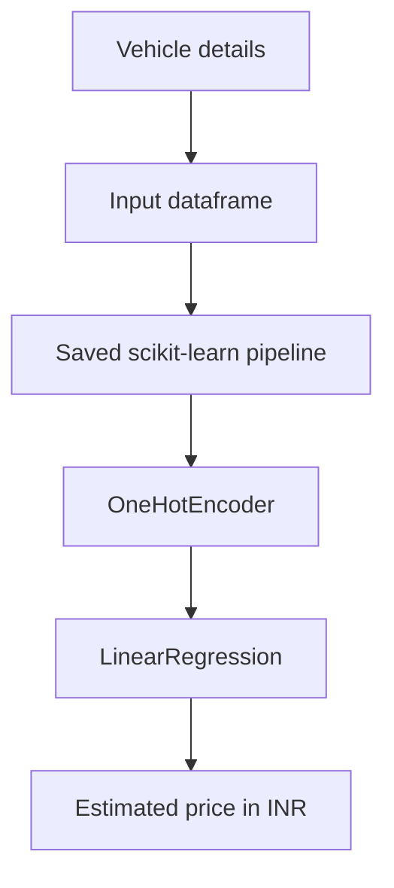

# Used Car Price Estimator

[](https://car-price-predictor-3.streamlit.app/)
[](https://github.com/CodeWithRjUdit/Car_Price_Predictor)
[](https://www.python.org/)
[](https://scikit-learn.org/)

A Streamlit application that estimates the resale price of a used car from selected vehicle details. It uses the trained scikit-learn pipeline already stored in this repository.

**This project is an educational machine-learning demonstration.** Its estimate is based on historical listing data and should not be interpreted as a current market valuation.

## Live application

**Try the deployed application:** [https://car-price-predictor-3.streamlit.app/](https://car-price-predictor-3.streamlit.app/)

The application is hosted on Streamlit Community Cloud. The deployment uses the `main` branch and `app.py` as its entrypoint.

## Project overview

Select the manufacturer, car model, fuel type, manufacture year, and kilometres driven. The application sends those values to the committed scikit-learn pipeline and displays an estimated resale price in Indian rupees.

The app loads its dropdown options and observed feature ranges from `Cleaned_Car.csv`. Model inference is separated from the Streamlit interface so the prediction code can also be exercised by the local smoke-test script.

## How it works

The application accepts five features:

| Feature | Description |
|---|---|
| `name` | Car model label used by the original training data |
| `company` | Manufacturer |
| `year` | Year of manufacture |
| `kms_driven` | Kilometres driven |
| `fuel_type` | Fuel category |

The saved estimator is a scikit-learn pipeline containing:

1. `OneHotEncoder` for the categorical features `name`, `company`, and `fuel_type`.
2. `LinearRegression` for the price estimate.

The application passes the original five-column dataframe directly to this pipeline. It does not separately re-encode the input.



## Repository structure

```text
Car_Price_Predictor/
├── app.py
├── car_price_predictor/
│   ├── __init__.py
│   ├── data.py
│   └── inference.py
├── docs/
│   ├── MODEL_CARD.md
│   └── PROJECT_STRUCTURE.md
├── scripts/
│   └── verify_artifacts.py
├── .streamlit/
│   └── config.toml
├── .gitignore
├── requirements.txt
├── Car_Price_Predictor.ipynb
├── Cleaned_Car.csv
├── quikr_car.csv
└── LinearRegressionModel.pkl
```

## Run locally

Python 3.11 is the recommended starting point because the notebook metadata records Python 3.11.5.

### 1. Clone the repository

```bash
git clone https://github.com/CodeWithRjUdit/Car_Price_Predictor.git
cd Car_Price_Predictor
```

### 2. Create and activate a virtual environment

Windows:

```powershell
py -3.11 -m venv .venv
.venv\Scripts\Activate.ps1
```

macOS / Linux:

```bash
python3.11 -m venv .venv
source .venv/bin/activate
```

### 3. Install dependencies and run

```bash
python -m pip install --upgrade pip
pip install -r requirements.txt
streamlit run app.py
```

## Verify the saved artifacts

Run the smoke test from the repository root:

```bash
python scripts/verify_artifacts.py
```

It loads the cleaned dataset and saved model, then checks that a representative row produces a finite prediction.

## Deploy on Streamlit Community Cloud

1. Open [Streamlit Community Cloud](https://share.streamlit.io/).
2. Choose **Create app** and select the existing repository.
3. Set repository to `CodeWithRjUdit/Car_Price_Predictor`, branch to `main`, and entrypoint to `app.py`.
4. In **Advanced settings**, select Python 3.11 to match the notebook's recorded Python environment.
5. Deploy the app. Choose an available `streamlit.app` subdomain.

The root-level `requirements.txt` declares the Python packages used by the app. Streamlit Community Cloud uses this file to install dependencies. See the [official dependency guide](https://docs.streamlit.io/deploy/streamlit-community-cloud/deploy-your-app/app-dependencies) and [deployment guide](https://docs.streamlit.io/deploy/streamlit-community-cloud/deploy-your-app/deploy).

## Model and data notes

- The committed cleaned dataset contains 815 records.
- The cleaned observations cover manufacture years 1995–2019 and recorded prices from ₹30,000 to ₹31,00,000.
- The notebook reports an `R²` score of approximately `0.8667` on a single 10% random test split (`random_state=655`). This is the notebook's reported result, not an independently reproduced benchmark.
- The original notebook determined the one-hot category lists before the train/test split. For a rigorous new evaluation, the preprocessing and estimator should be fitted entirely within each training split.
- The model is not retrained when the app starts. It loads the committed `LinearRegressionModel.pkl` artifact.

## Limitations

The model is trained on a relatively small historical dataset. It does not account for location, vehicle condition, ownership count, accident history, insurance, transmission, service records, or current market changes. Linear regression can also produce implausible values for unusual feature combinations; the app explicitly warns when a prediction is non-positive or outside the observed training-price range.

The serialized model artifact records scikit-learn version `1.3.0`. The deployment dependencies pin scikit-learn to that version to match the environment recorded inside the pickle. Python 3.11 is selected to match the notebook metadata.

## Security

The model is loaded from a pickle file. Pickle files can execute code during deserialization, so only use the trusted model artifact committed with this repository. Do not replace it with an untrusted pickle file.

## Author

[CodeWithRjUdit](https://github.com/CodeWithRjUdit)
